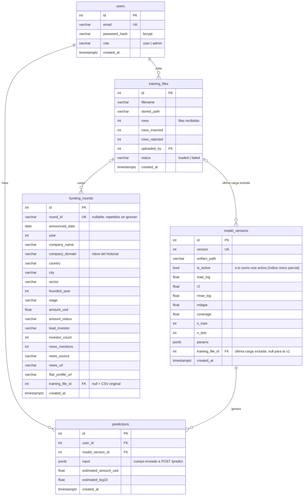

# Diagrama entidad-relación

Generado a partir de `alembic/versions/0001_initial_schema.py`. GitHub renderiza el bloque mermaid.

`funding_rounds` guarda las columnas del CSV **sin `news_excerpt`**: esa columna contiene el monto escrito (fuga de datos) y nunca se almacena.

